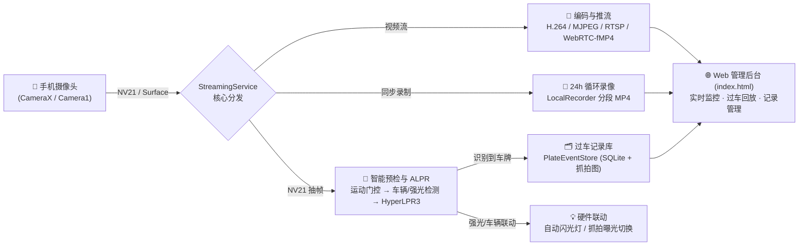

# Android ANPR（车牌抓拍）软件总体架构与运作原理

- **应用名称**：`Android ANPR` / `车牌抓拍`
- **包名与版本**：`io.github.jj82b.android_anpr` · `v0.50.1`（`versionCode 501`）
- **运行平台**：Android 7.0+（`minSdk 24`, `targetSdk 34`）

---

## 一、一句话看懂软件如何运作

**Android ANPR** 把一台普通 Android 手机变成**集“IP 摄像头推流 + 离线车辆/强光预检 + 车牌识别 + 24h 循环录像 + 过车回放管理”于一体的边缘计算抓拍终端**。

核心中枢是前台常驻服务 **`StreamingService`**，它像总控台一样把手机的 **Camera2/Camera1 相机、麦克风/扬声器、本地存储、HTTPS Web 服务、RTSP/ONVIF 服务以及 AI 推理引擎** 串联成四条并行流水线：

---

## 二、启动与生命周期

1. **应用入口（`MainActivity` / `BootReceiver`）**
   - 用户打开 App（或开机自启广播触发 `BootReceiver`）后，请求相机、录音与存储权限，并启动前台服务 **`StreamingService`**。
   - 手机本地界面仅提供状态概览、开关服务与跳转 `SettingsActivity`；绝大多数调参、监控与回放都在同一局域网下的 **Web 管理后台** 完成。
2. **后台常驻（`StreamingService`）**
   - 持有前台服务通知与 WakeLock，确保息屏或切后台时摄像头、录像和识别流水线不断流。
   - 初始化并持有四大核心实例：`CaptureBackend`（相机）、`StreamingServerHelper`（HTTPS/HTTP 服务器）、`LocalRecorder`（循环录像）与 `PlateRecognizer`（AI 识别）。

---

## 三、四大核心运作流水线

### 1. 相机采集与音视频推流（详情见小文档）
- 相机通过 `CameraXCapture`（Camera2）或 `Camera1Capture` 采集画面，一路经 `CameraGlPipe` / 硬件编码器输出 **H.264** 或 **MJPEG** 给网页、**RTSP** 客户端和 **ONVIF** 客户端（Home Assistant / UniFi Protect 等）。
- 支持网页端实时切换摄像头、分辨率、手动 ISO/快门、变焦、对焦距离，以及双向语音对讲（`AacAudioSource` + Push-to-Talk）。
- 📖 详细说明：[相机采集与推流流水线](Camera_And_Streaming_Pipeline.md)

### 2. 智能预检与 ALPR 车牌识别（详情见小文档）
为了在手机上做到**低功耗、不误触发、夜间不洗白**，识别链路采用**多级漏斗过滤**：
1. **32×18 亮度网格运动门控（MotionGate）**：静止画面下仅以极低开销轮询，不触发重型神经网络；仅对 ALPR 推理做静止退避，动作与强光检测始终全速响应。
2. **160×90 Top-Hat 运动强光检测**：通过可分离 `9×9` 白顶帽形态学 + YCbCr 特征，识别正在移动的白色前大灯与红色尾灯，可联动自动闪光灯与夜间抓拍曝光策略。
3. **车辆预检（方案一 / 方案二）**：
   - **方案一**：几何宽高比 + 帧间移动轨迹启发式过滤（0 ms）；
   - **方案二**：TFLite 轻量车辆检测（内置 EfficientDet-Lite0 / Lite1 / MobileNetV1-SSD，并支持网页上传自定义 `.tflite` / YOLOv8n 模型）。
4. **HyperLPR3 车牌识别**：对通过预检的画面（或裁剪后的车辆/运动区块）执行车牌定位与字符识别，支持 CPU 多线程与 OpenCL GPU 后端。
- 📖 详细说明：[运动门控、车辆预检与强光抓拍机制](Vehicle_And_Glare_PreDetection.md)

### 3. 24h 循环录像与过车事件存储
- **24h 循环录像（`LocalRecorder`）**：按设定分段时长（1~30 分钟）连续录制 `.mp4`，并按容量上限自动滚动清理最旧分段；同时支持视频流中写入分段起点时间戳。
- **过车事件记录（`PlateEventStore`）**：识别到车牌并去重防抖后，将车牌号、置信度、车牌类型、识别框坐标、全景抓拍 JPEG、对应录像文件名及段内时间偏移写入 SQLite 数据库，使回放界面能够点击记录**秒级定位到对应录像帧**。
- 📖 已有专项文档：[循环录像实现](Loop_Recording_Implementation.md) · [过车事件存储](Plate_Event_Store_Implementation.md)

### 4. Web 管理后台与 HTTP API（详情见小文档）
- 手机内置的 `StreamingServerHelper` 直接托管 `assets/index.html` 单页应用，提供三大核心视图与全套 REST API：
  - **📺 实时监控**：视频流 + 车牌/车辆/运动/强光实时框叠加 + 防误触折叠参数面板；
  - **🎞️ 过车回放**：带录像标记点的月历选择器 + 最长 24h（含上午/下午缩放）无缝时间轴；
  - **📁 记录管理**：录像文件与过车记录双列表多选批量管理与删除。
- 📖 详细说明：[Web 管理后台与接口说明](WebUI_And_API_Reference.md)

---

## 四、全部专项子文档索引

| 分类 | 文档 | 说明 |
| :--- | :--- | :--- |
| **核心原理** | [Camera_And_Streaming_Pipeline.md](Camera_And_Streaming_Pipeline.md) | 相机采集、GL 管线、H.264/MJPEG/RTSP 推流 |
| **核心原理** | [Vehicle_And_Glare_PreDetection.md](Vehicle_And_Glare_PreDetection.md) | 运动门控、方案一/二车辆预检、Top-Hat 强光检测与抓拍曝光 |
| **核心原理** | [WebUI_And_API_Reference.md](WebUI_And_API_Reference.md) | 网页端标签页功能、防误触面板与后端 HTTP API |
| **识别与性能** | [HyperLPR3_SDK_Reference.md](HyperLPR3_SDK_Reference.md) | HyperLPR3 SDK 参数与调用说明 |
| **识别与性能** | [HyperLPR3_GPU_OpenCL_Build_Guide.md](HyperLPR3_GPU_OpenCL_Build_Guide.md) | OpenCL GPU 推理编译与启用指南 |
| **识别与性能** | [ALPR_Motion_And_Capture_Modes.md](ALPR_Motion_And_Capture_Modes.md) | 运动门控、动态裁剪与夜间抓拍曝光模式 |
| **识别与性能** | [ALPR_Downsample_And_Buffer_Optimization.md](ALPR_Downsample_And_Buffer_Optimization.md) | NV21 降采样与缓冲优化 |
| **识别与性能** | [ALPR_PingPong_Double_Buffer_Optimization.md](ALPR_PingPong_Double_Buffer_Optimization.md) | 双缓冲乒乓零阻塞优化 |
| **识别与性能** | [Software_Compute_Bottlenecks_Analysis.md](Software_Compute_Bottlenecks_Analysis.md) | 整机算力瓶颈分析 |
| **存储与回放** | [Loop_Recording_Implementation.md](Loop_Recording_Implementation.md) | 24h 循环录像实现细节 |
| **存储与回放** | [Plate_Event_Store_Implementation.md](Plate_Event_Store_Implementation.md) | 过车事件 SQLite 与抓拍图存储 |
| **存储与回放** | [Playback_Range_And_WebUI_Implementation.md](Playback_Range_And_WebUI_Implementation.md) | HTTP Range 分片拖动与无缝时间轴回放 |
| **问题修复记录** | [Live_Preview_Refocus_Flash_Fix.md](Live_Preview_Refocus_Flash_Fix.md) | 切入实时监控画面闪烁/重新对焦修复记录 |
| **问题修复记录** | [Bind_Failed_EADDRINUSE_Fix.md](Bind_Failed_EADDRINUSE_Fix.md) | 端口占用 `EADDRINUSE` 修复记录 |
| **问题修复记录** | [Huawei_H264_Performance_Optimization.md](Huawei_H264_Performance_Optimization.md) | 华为机型 H.264 编码性能优化 |
