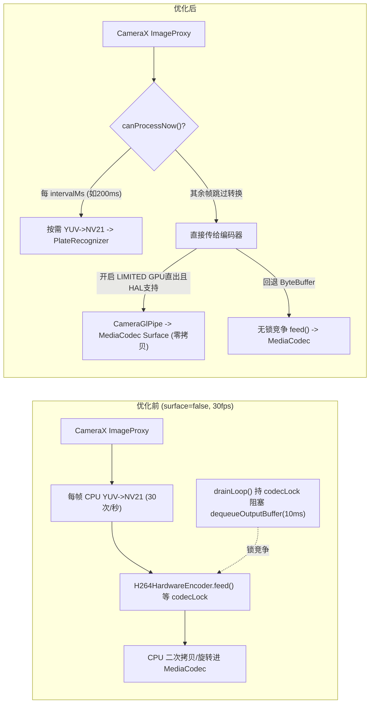

# 华为设备 H.264 推流与录制卡顿性能优化记录

## 一、问题背景与根因分析

### 1. 现象
- 同一台华为设备上，**MJPEG** 推流到网页端流畅，但 **H.264** 网页推流及本地 H.264 录制文件均出现周期性卡顿/掉帧。
- 通过 Logcat 查看 `H264HardwareEncoder` 启动日志，确认设备运行在 `surface=false`（ByteBuffer 模式）。

### 2. 根因拆解
1. **`LIMITED` 设备被限制走 CPU ByteBuffer 模式（`surface=false`）**
   - 原 `StreamingService.supportsSurfaceEncoder()` 仅允许 `INFO_SUPPORTED_HARDWARE_LEVEL_FULL` 和 `INFO_SUPPORTED_HARDWARE_LEVEL_3`。许多华为设备报告为 `LIMITED`，因此被强制走 CPU 逐帧拷贝模式。
2. **`H264HardwareEncoder` 存在 `codecLock` 锁竞争**
   - `drainLoop()` 输出线程在持有 `synchronized(codecLock)` 的状态下调用 `codec.dequeueOutputBuffer(info, 10000)`（最长阻塞 10ms），导致 `feed()` 送帧线程等待同一把锁，打乱送帧节奏。
3. **`CameraXCapture` 每帧无条件执行全帧 `YUV -> NV21` 转换**
   - `ImageAnalysis` 的单线程 `analysisExec` 在每一帧（如 30fps）都要先执行一次全帧 `convertYUV420toNV21(...)` 并分配/复用大数组，然后再把 `ImageProxy` 交给 `H264HardwareEncoder.feed()` 再拷贝/旋转一次，造成大量 CPU 占用与内存带宽竞争。
4. **系统省电调度与默认高码率压力**
   - 缺乏 `PARTIAL_WAKE_LOCK` 与 `WifiLock`，华为 EMUI/HarmonyOS 在熄屏或低负载时容易压低 CPU 频率并让 Wi-Fi 进入省电休眠。
   - 默认 H.264 码率按 `w * h * 6` 计算（1080p 约 12.4 Mbps），WebUI 此前无法直接下调码率以适配不同设备编码器吞吐能力。

---

## 二、优化前后管线对比

---

## 三、具体优化措施与性能改善原理

### 1. 解除 `H264HardwareEncoder` 的 `codecLock` 锁阻塞
- **修改文件**：`app/src/main/kotlin/com/github/digitallyrefined/androidipcamera/helpers/H264HardwareEncoder.kt`
- **改动内容**：在 `drainLoop()` 中移除 `codec.dequeueOutputBuffer(info, 10000)`、`codec.outputFormat`、`codec.getOutputBuffer(idx)`、`codec.releaseOutputBuffer(idx, false)` 外层的 `synchronized(codecLock)`。
- **性能收益**：`MediaCodec` 的输入队列与输出队列本身是解耦的；解除互斥锁后，`drainLoop()` 等待输出缓冲的 10ms 超时不再阻塞 `feed()` 送帧线程，消除了周期性送帧停顿。

### 2. `CameraXCapture` 改为按需执行 `YUV -> NV21` 转换
- **修改文件**：
  - `app/src/main/kotlin/com/github/digitallyrefined/androidipcamera/helpers/PlateRecognizer.kt`（新增 `canProcessNow()`）
  - `app/src/main/kotlin/com/github/digitallyrefined/androidipcamera/helpers/CameraXCapture.kt`
- **改动内容**：在 `ImageAnalysis` 回调中，仅当 `plateRecognizer.canProcessNow()` 为 `true`（达到 `intervalMs` 采样间隔且当前无推理任务在执行）时，才执行 `convertYUV420toNV21(...)` 并更新 `latestNv21` 缓存；其余帧直接跳过 NV21 转换进入 `onFrame(img)`。
- **性能收益**：以 30fps 视频流、`200ms` 采样间隔为例，全帧 CPU `YUV -> NV21` 转换次数从 **30 次/秒降至约 5 次/秒（减少约 83% 的无效 CPU 拷贝）**，显著降低 `analysisExec` 线程耗时，同时仍保持每秒约 5 帧的快照兜底缓存更新。

### 3. 支持在 WebUI 一键放开 `LIMITED` 设备的 GPU Surface 零拷贝直出
- **修改文件**：
  - `app/src/main/kotlin/com/github/digitallyrefined/androidipcamera/StreamingService.kt`（`supportsSurfaceEncoder()` 与 `handleRemoteControl("allow_limited_surface")`）
  - `app/src/main/kotlin/com/github/digitallyrefined/androidipcamera/helpers/StreamingServerHelper.kt`（`StreamSettings` 与 `/info.json`）
  - `app/src/main/assets/index.html`（Settings 面板中的 `LIMITED GPU直出` 按钮）
- **改动内容**：将 `allow_limited_surface` 持久化到 `SharedPreferences`，开启后允许 `INFO_SUPPORTED_HARDWARE_LEVEL_LIMITED` 设备尝试绑定 `CameraGlPipe -> MediaCodec.inputSurface`。若设备 HAL 确实拒绝 3 路并发流，仍保留 `CameraXCapture` 原有的 `onEncoderSurfaceFallback` 自动回退机制。
- **性能收益**：只要华为设备 HAL 接受 3 路并发流，H.264 编码帧将不再经过 `analysisExec` 的 CPU YUV 拷贝与旋转，直接由相机经 OpenGL ES 纹理零拷贝送入硬件编码器，从根本上解决 CPU 拷贝瓶颈。

### 4. WebUI 新增 H.264 动态码率控制与采样间隔调节
- **修改文件**：
  - `app/src/main/kotlin/com/github/digitallyrefined/androidipcamera/helpers/H264HardwareEncoder.kt`（`updateBitrate(bps)`）
  - `app/src/main/kotlin/com/github/digitallyrefined/androidipcamera/helpers/H264StreamingEncoder.kt`
  - `app/src/main/kotlin/com/github/digitallyrefined/androidipcamera/StreamingService.kt`
  - `app/src/main/assets/index.html`
- **改动内容**：
  - 在 `H.264` / `MJPEG` 按钮下方提供 `H.264 Bitrate (kbps, 0 = Auto)`，通过 `MediaCodec.PARAMETER_KEY_VIDEO_BITRATE` 实时调整编码码率（无需重启编码器）。
  - 在 ALPR 高级选项中开放 `intervalMs`（50–2000ms）采样间隔调节，便于在性能受限设备上平衡识别实时性与 CPU 负载。

### 5. 补充 `PARTIAL_WAKE_LOCK` 与 `WifiLock` 防休眠降频
- **修改文件**：
  - `app/src/main/AndroidManifest.xml`（`android.permission.WAKE_LOCK`）
  - `app/src/main/kotlin/com/github/digitallyrefined/androidipcamera/StreamingService.kt`（`acquirePowerLocks()` / `releasePowerLocks()`）
- **改动内容**：服务运行期间持有 `PowerManager.PARTIAL_WAKE_LOCK` 与 `WifiManager.WifiLock`（Android 10+ 使用 `WIFI_MODE_FULL_LOW_LATENCY`，低版本使用 `WIFI_MODE_FULL_HIGH_PERF`），服务销毁时释放。
- **性能收益**：防止华为系统在熄屏或后台推流期间对 CPU 降频及让 Wi-Fi 进入低功耗间歇唤醒（PSM），减少网页端周期性卡顿。

---

## 四、验证与排查建议

1. **查看 Logcat 确认编码路径**：
   - 过滤 `H264HardwareEncoder`，点击 WebUI 的 `LIMITED GPU直出` 按钮后，观察是否变为 `surface=true`；
   - 若看到 `CameraX SurfaceProvider fallback triggered`，说明该机型 HAL 不支持 Surface 与分析流并发，会自动安全退回 `surface=false`，此时依赖上述优化 1、2、4、5 改善流畅度。
2. **推荐参数起点（华为设备）**：
   - 若走 `surface=false`：可将 `H.264 Bitrate` 设为 `1500`–`3000` kbps、`Frame Rate` 设为 `20`–`25` fps、ALPR 采样间隔设为 `300`–`500ms`。
   - 若成功启用 `surface=true`：保持默认或按网络带宽调节码率即可。
