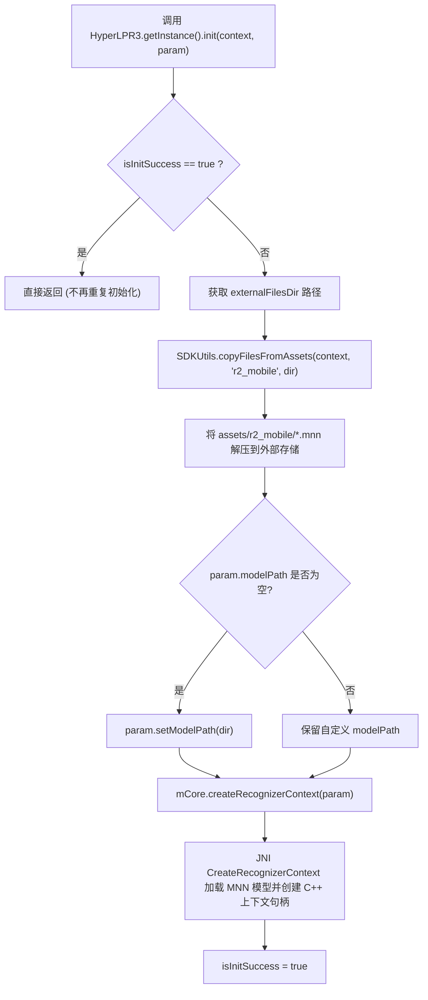
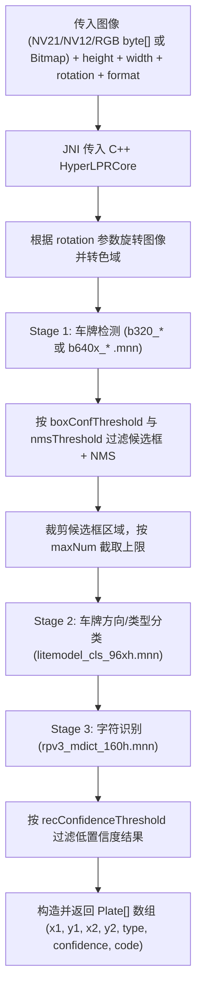

# HyperLPR3 Android SDK (`1.0.3`) 工作流程与 API 速查文档

> 本文档基于项目依赖 `com.github.HyperInspire:hyperlpr3-android-sdk:1.0.3` 实际字节码（`hyperlpr3-android-sdk-1.0.3-runtime.jar`）与内置模型资产整理。

---

## 一、关于“修改 SDK 输出 `boxConf`”的说明

当前项目通过 Gradle 引入的是**预编译二进制 AAR**（只包含 `.class` 与编译好的 `libhyperlpr3.so`，工作区中不包含 C++ 源码）：
- 第一阶段的 `boxConf`（检测框置信度）在 `libhyperlpr3.so` 内部计算并用于过滤候选框，**未通过 JNI 传回给 Java 层的 `Plate` 对象**。
- 因此**无法在不重新编译 C++ 源码的情况下直接输出 `boxConf`**。
- 若要改造，需获取开源项目 `szad670401/HyperLPR` 的 C++ 与 Android 源码，按以下步骤修改并重编：
  1. 在 C++ 识别结果结构体中保留第一阶段的 `box_conf` 字段；
  2. 在 `Plate.java` 中增加 `private float boxConfidence;` 及 getter/setter；
  3. 在 JNI 桥接层（`PlateRecognitionFromBuffer` / `PlateRecognitionFromImage`）把 `box_conf` 写入 Java `Plate` 对象；
  4. 使用 Android NDK 重新编译 `libhyperlpr3.so`，以本地 Module 或本地 AAR 替换 `app/build.gradle` 中的远程依赖。

---

## 二、HyperLPR3 SDK 内部工作流程

### 1. 初始化阶段（`init`）

### 2. 推理阶段（`plateRecognition`）

**内置模型文件（`assets/r2_mobile/`）：**
- `b320_backbone_h.mnn` / `b320_header_h.mnn`：`DETECT_LEVEL_LOW` 使用的 320×320 车牌检测模型
- `b640x_backbone_h.mnn` / `b640x_head_h.mnn`：`DETECT_LEVEL_HIGH` 使用的 640×640 车牌检测模型
- `litemodel_cls_96xh.mnn`：车牌分类/双层与倾斜校正相关模型
- `rpv3_mdict_160h.mnn`：车牌字符识别模型

---

## 三、SDK 可调用 API 速查文档

### 1. `com.hyperai.hyperlpr3.HyperLPR3`（主入口单例）

继承自 `TypeDefine`，实现 `APIDefine` 接口。

| 方法签名 | 说明 |
| --- | --- |
| `public static final HyperLPR3 getInstance()` | 获取全局单例。 |
| `public void init(Context context, HyperLPRParameter parameter)` | 首次调用会解压 `r2_mobile` 模型并创建 C++ 识别上下文。**注意：内部有 `isInitSuccess` 锁，再次调用无效。** |
| `public Plate[] plateRecognition(byte[] data, int height, int width, int rotation, int format)` | 从字节流识别车牌。**注意参数顺序是 `(data, height, width, rotation, format)`，高在前、宽在后。** |
| `public Plate[] plateRecognition(Bitmap bitmap, int rotation, int format)` | 从 Android `Bitmap` 识别车牌（内部提取 `getPixels` 转给 JNI）。 |
| `public void release()` | 释放底层 `mCore` 持有的 C++ 上下文句柄（**注意：不会重置 `isInitSuccess`**）。 |

---

### 2. `com.hyperai.hyperlpr3.bean.HyperLPRParameter`（初始化参数）

支持链式调用（Builder 风格）。

| 方法 | 类型 | 默认值 | 说明 |
| --- | --- | --- | --- |
| `setDetLevel(int)` / `getDetLevel()` | `int` | `0` (`DETECT_LEVEL_LOW`) | 检测输入尺寸级别：`0`（320×320，速度快）或 `1`（640×640，精度高）。 |
| `setMaxNum(int)` / `getMaxNum()` | `int` | `3` | 单帧最多返回的车牌数量上限。 |
| `setBoxConfThreshold(float)` / `getBoxConfThreshold()` | `float` | `0.25f` | 第一阶段车牌检测框置信度阈值，越高越严格。 |
| `setNmsThreshold(float)` / `getNmsThreshold()` | `float` | `0.6f` | 第一阶段非极大值抑制（NMS）IoU 阈值，用于合并重叠检测框。 |
| `setRecConfidenceThreshold(float)` / `getRecConfidenceThreshold()` | `float` | `0.85f` | 第二阶段字符识别置信度阈值，低于此值的结果不会返回。 |
| `setThreads(int)` / `getThreads()` | `int` | `1` | MNN 推理使用的 CPU 线程数。 |
| `setUseHalf(boolean)` / `isUseHalf()` | `boolean` | `true` | 是否启用 FP16 半精度推理。 |
| `setModelPath(String)` / `getModelPath()` | `String` | `null` | 自定义模型目录路径；为 `null` 或空时 `init()` 会自动填充为 `externalFilesDir/`。 |

---

### 3. `com.hyperai.hyperlpr3.bean.Plate`（识别结果对象）

| 方法 | 返回类型 | 说明 |
| --- | --- | --- |
| `getX1()` / `setX1(float)` | `float` | 车牌框左上角 X 坐标（像素）。 |
| `getY1()` / `setY1(float)` | `float` | 车牌框左上角 Y 坐标（像素）。 |
| `getX2()` / `setX2(float)` | `float` | 车牌框右下角 X 坐标（像素）。 |
| `getY2()` / `setY2(float)` | `float` | 车牌框右下角 Y 坐标（像素）。 |
| `getCode()` / `setCode(String)` | `String` | 识别出的车牌号码文本（如 `京A12345`）。 |
| `getConfidence()` / `setConfidence(float)` | `float` | 字符识别置信度（`0.0f` ~ `1.0f`）。 |
| `getType()` / `setType(int)` | `int` | 车牌类型编号，对应 `TypeDefine.PLATE_TYPE_*` 及 `PLATE_TYPE_MAPS`。 |
| `toString()` | `String` | 格式化输出车牌信息。 |

---

### 4. `com.hyperai.hyperlpr3.settings.TypeDefine`（常量定义）

`HyperLPR3` 继承了此类，所有常量均可通过 `HyperLPR3.XXX` 直接访问。

**旋转方向（`rotation` 参数）：**
- `CAMERA_ROTATION_0 = 0`
- `CAMERA_ROTATION_90 = 1`
- `CAMERA_ROTATION_180 = 2`
- `CAMERA_ROTATION_270 = 3`

**检测等级（`detLevel` 参数）：**
- `DETECT_LEVEL_LOW = 0`
- `DETECT_LEVEL_HIGH = 1`

**输入图像格式（`format` 参数）：**
- `STREAM_RGB = 0`
- `STREAM_BGR = 1`
- `STREAM_RGBA = 2`
- `STREAM_BGRA = 3`
- `STREAM_YUV_NV12 = 4`
- `STREAM_YUV_NV21 = 5`

**车牌类型（`Plate.getType()`）：**
- `PLATE_TYPE_UNKNOWN = -1`
- `PLATE_TYPE_BLUE = 0`（蓝牌）
- `PLATE_TYPE_YELLOW_SINGLE = 1`（黄牌单层）
- `PLATE_TYPE_WHILE_SINGLE = 2`（白牌单层，注：SDK 原拼写为 `WHILE`）
- `PLATE_TYPE_GREEN = 3`（绿牌新能源）
- `PLATE_TYPE_BLACK_HK_MACAO = 4`（黑牌港澳）
- `PLATE_TYPE_HK_SINGLE = 5`（香港单层）
- `PLATE_TYPE_HK_DOUBLE = 6`（香港双层）
- `PLATE_TYPE_MACAO_SINGLE = 7`（澳门单层）
- `PLATE_TYPE_MACAO_DOUBLE = 8`（澳门双层）
- `PLATE_TYPE_YELLOW_DOUBLE = 9`（黄牌双层）
- `PLATE_TYPE_MAPS`：`String[]` 中文类型映射表（索引 `0`–`9`）。

---

### 5. `com.hyperai.hyperlpr3.core.HyperLPRCore`（底层 JNI 封装）

`HyperLPR3` 内部持有的底层实例，为 `public` 类，可在需要多实例或热重载参数时直接使用（使用前需确保模型文件已解压且 `modelPath` 非空）：

| 方法签名 | 说明 |
| --- | --- |
| `public HyperLPRCore()` | 构造一个新的底层推理上下文容器（静态块会自动 `System.loadLibrary("hyperlpr3")`）。 |
| `public void createRecognizerContext(HyperLPRParameter param)` | 创建底层 C++ 识别上下文并保存句柄 `ctxHandle_`。 |
| `public Plate[] plateRecognitionFromBuffer(byte[] data, int height, int width, int rotation, int format)` | 直接从字节缓冲执行识别。 |
| `public Plate[] plateRecognitionFromImage(int[] pixels, int height, int width, int rotation, int format)` | 直接从 ARGB int 数组执行识别。 |
| `public int release()` | 释放当前 `ctxHandle_` 对应的 C++ 识别上下文。 |

---

### 6. `com.hyperai.hyperlpr3.utils.SDKUtils`（辅助工具类）

| 方法签名 | 说明 |
| --- | --- |
| `public static void copyFilesFromAssets(Context context, String assetsPath, String savePath)` | 递归将 `assets` 目录下的文件复制到指定存储路径。 |
| `public static void mkdirsFeaturesAssets(Context context, String assetsPath, String savePath, String dirName)` | 创建目录并复制指定资产文件。 |
| `public static String saveBitmap(String path, String name, Bitmap bitmap)` | 将 `Bitmap` 保存到指定路径。 |
| `public static boolean cropperBitmap(Bitmap bitmap, int[] rect, String path, String name)` | 按矩形区域裁剪 `Bitmap` 并保存。 |
| `public static Bitmap getImageFromAssetsFile(Context context, String fileName)` | 从 `assets` 读取图片为 `Bitmap`。 |
