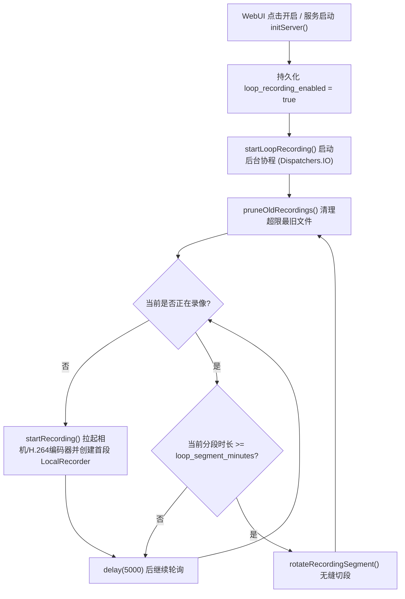

# 24 小时循环分段录像与自动清理实现记录

本文档记录回放系统 **第 1 步（24 小时不间断分段录像 + 循环覆盖清理）** 的设计与代码实现细节。

---

## 一、核心目标

1. **避免单文件过大与异常损坏**：按固定时间间隔（`1–30` 分钟）自动切分为独立的 MP4 文件。
2. **无缝切段**：切分分段时不中断 H.264 编码器，新分段从关键帧（IDR）起录，减少衔接丢帧。
3. **存储空间可控（FIFO 循环覆盖）**：限制录像总容量上限，并保留至少 `512MB` 系统可用空间，自动删除最旧分段。
4. **状态持久化与 WebUI 管理**：支持网页端启停、调节分段时长与容量上限，并在服务重启后自动恢复循环录像。

---

## 二、整体架构与流程



---

## 三、分模块实现细节

### 1. `LocalRecorder.kt`：暴露当前分段文件名
- **文件路径**：`app/src/main/kotlin/com/github/digitallyrefined/androidipcamera/helpers/LocalRecorder.kt`
- **关键改动**：
  - 新增 `@Volatile var currentFileName: String? = null`（只读外部访问，`private set`）。
  - 在 `start()` 生成文件名后立即记录 `currentFileName = filename`，供循环清理逻辑在删除旧文件时**跳过正在写入的活跃分段**。

### 2. `StreamingService.kt`：分段调度、无缝切段与 FIFO 清理
- **文件路径**：`app/src/main/kotlin/com/github/digitallyrefined/androidipcamera/StreamingService.kt`
- **持久化配置（`SharedPreferences`）**：
  - `loop_recording_enabled`（`Boolean`，默认 `false`）
  - `loop_segment_minutes`（`Int`，默认 `5`，范围 `1..30`）
  - `loop_max_storage_gb`（`Int`，默认 `4`，范围 `1..128`）
- **生命周期绑定**：
  - `initServer()`：若 `isLoopRecordingEnabled()` 为 `true`，自动调用 `startLoopRecording()` 恢复录像。
  - `onDestroy()`：取消 `loopRecordingJob` 并由 `safeStopRecording()` 安全封装当前分段。
- **无缝切段 `rotateRecordingSegment()`**（由 `loopRotateLock` 串行保护）：
  1. 获取当前活跃编码器 `h264StreamingEncoder?.h264HardwareEncoder` 与旧 `oldRecorder = localRecorder`。
  2. 新建并启动 `newRecorder = LocalRecorder(this, enc.width, enc.height)`（先打开新文件与 `MediaMuxer`）。
  3. 将编码器回调 `enc.onRecordFrame` 原子切换为写入 `newRecorder.feedFrame(...)`，并调用 `enc.requestKeyFrame()` 使新分段立即以关键帧起录。
  4. 更新 `localRecorder = newRecorder`，随后调用 `oldRecorder.stop()` 完成旧 MP4 的 `MediaMuxer` 封装与媒体库扫描。
- **循环覆盖清理 `pruneOldRecordings()`**：
  1. 通过 `RecordingsHelper.list(this)` 获取录像列表，过滤掉 `localRecorder?.currentFileName`，按 `lastModifiedMs` 升序排列（最旧在前）。
  2. 计算已占用总字节数 `totalBytes`，并通过 `StatFs` 读取存储剩余空间 `freeBytes`。
  3. 当 `totalBytes > maxBytes`（`loopMaxStorageGb * 1024^3`）或 `freeBytes < 512MB` 时，循环调用 `RecordingsHelper.delete(this, file.name)` 删除最旧文件，直至满足容量与安全余量要求。

### 3. `StreamingServerHelper.kt`：HTTP 接口 `/api/recording/loop`
- **文件路径**：`app/src/main/kotlin/com/github/digitallyrefined/androidipcamera/helpers/StreamingServerHelper.kt`
- **关键改动**：
  - 在构造函数新增 `onLoopRecordingGet: () -> String` 和 `onLoopRecordingSet: (Map<String, String>) -> String` 回调。
  - 在 `uri.contains("?")` 通用控制分支之前注册 `/api/recording/loop` 路由：
    - `GET /api/recording/loop`：返回当前状态 JSON：
      ```json
      {
        "enabled": true,
        "segmentMinutes": 5,
        "maxStorageGb": 4,
        "recording": true,
        "fileCount": 12,
        "usedMb": 640
      }
      ```
    - `POST /api/recording/loop?enabled=...&segmentMinutes=...&maxStorageGb=...`：更新配置、按需启停循环录像协程并返回最新状态 JSON。

### 4. `index.html`：WebUI 控制面板
- **文件路径**：`app/src/main/assets/index.html`
- **关键改动**：
  - 在右侧 Snapshot 区域下方新增 **24h 循环录像** 分组：
    - 启停按钮 `#loopRecToggleBtn`（运行中显示红色状态）
    - 分段时长下拉框 `#loopSegMinutes`（`1 / 3 / 5 / 10 / 15 / 30` 分钟）
    - 容量上限输入框 `#loopMaxStorageGb`（`1–128` GB）
    - 状态栏 `#loopRecMeta`（展示 `已录分段` 与 `已用 MB`）
  - 通过 `initLoopRecordingControls()` 在页面加载时拉取 `/api/recording/loop`，并每 `15s` 自动刷新一次分段数与空间占用。

---

## 四、后续可扩展接口（为第 2–4 步预留）

- `LocalRecorder` 已提供 `currentFileName` 与 `recordingStartTimeMs`，后续接入车牌事件落库时，可直接计算：
  - `videoFile = localRecorder?.currentFileName`
  - `videoOffsetMs = System.currentTimeMillis() - (localRecorder?.recordingStartTimeMs ?: 0L)`
- 即可精确定位每辆车出现在哪一个分段文件以及第几秒。
