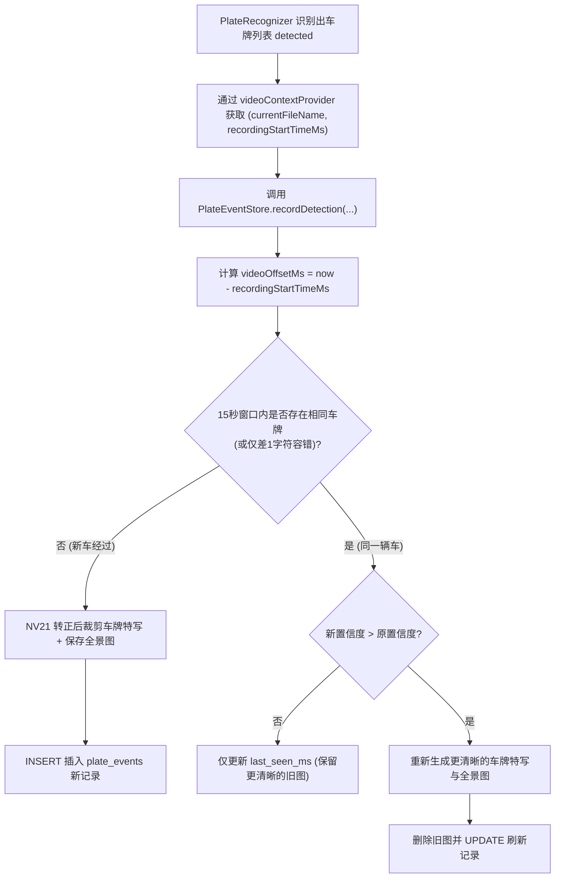

# 过车车牌事件去重、抓拍落库与检索接口实现记录（第 2 步）

本文档记录回放系统 **第 2 步（过车事件聚合去重 + 最佳帧抓拍图 + SQLite 落库 + 录像偏移关联 + 联动清理与查询 API）** 的实现细节。

---

## 一、核心设计目标

1. **避免重复刷屏**：同一辆车在镜头前停留数秒会触发多次识别，需要在 `15s` 时间窗口内聚合为单次过车事件，并保留**置信度最高**的那一帧结果与抓拍图。
2. **图文并茂**：同时保存**车牌特写裁剪图**（带边距扩展）与**压缩全景抓拍图**（最大宽 `960px`）。
3. **关联录像定位**：记录事件发生时正在录制的 MP4 分段文件名（`video_file`）及相对该段视频开头的毫秒偏移量（`video_offset_ms`）。
4. **生命周期联动**：当第 1 步的循环录像清理删除旧 MP4 分段时，自动同步删除关联的数据库事件与抓拍图片，避免孤儿文件堆积。

---

## 二、数据流与去重流程

---

## 三、分模块实现细节

### 1. `PlateEventStore.kt`：SQLite 存储与图像裁剪
- **文件路径**：`app/src/main/kotlin/com/github/digitallyrefined/androidipcamera/helpers/PlateEventStore.kt`
- **数据库结构**：`anpr_events.db` 中的 `plate_events` 表
  - `id`：自增主键
  - `plate_code`：车牌号文本
  - `plate_type`：车牌类型编号（对应 HyperLPR3 `TypeDefine`）
  - `confidence`：识别置信度
  - `event_time_ms`：首次识别时间戳（毫秒）
  - `last_seen_ms`：最近一次命中该事件的时间戳（毫秒）
  - `video_file`：关联的录像分段文件名（未录像时为 `NULL`）
  - `video_offset_ms`：事件在该 MP4 分段中的时间偏移（毫秒）
  - `plate_img` / `snap_img`：保存在 `appContext.filesDir/alpr_snaps/` 下的特写与全景 JPEG 文件名
  - 索引：`idx_plate_events_time(event_time_ms DESC)`、`idx_plate_events_video(video_file)`
- **去重策略（`findRecentMatchingEvent` + `isSamePlate`）**：
  - 查询 `last_seen_ms >= now - 15_000L` 的最近记录。
  - 若车牌字符串完全相同，或长度相同（`>= 6`）且汉明距离 `<= 1`（吸收单字符识别抖动），即判定为同一过车事件。
- **抓拍裁剪（`saveEventImages`）**：
  - 将 `NV21` 帧经 `YuvImage` 压缩后解码为 `Bitmap`，按 `rotationDegrees` 旋转至正向。
  - 按 `Plate` 坐标 `(x1, y1, x2, y2)` 向外扩展约 `15%` 水平边距、`25%` 垂直边距裁剪保存 `plate_<ts>.jpg`（JPEG 质量 `90`）。
  - 将整帧按最大宽度 `960px` 等比缩放后保存 `snap_<ts>.jpg`（JPEG 质量 `75`）。
- **容量上限保护（`pruneExcessEventsLocked`）**：
  - 数据库总记录数超过 `5000` 条时，自动按 `event_time_ms ASC` 清理最旧记录及对应 JPEG 文件。

### 2. `PlateRecognizer.kt`：识别结果自动入库
- **文件路径**：`app/src/main/kotlin/com/github/digitallyrefined/androidipcamera/helpers/PlateRecognizer.kt`
- **关键改动**：
  - 在 `companion object` 新增 `@Volatile var videoContextProvider: (() -> Pair<String?, Long>)? = null`。
  - 在 `processNv21Async` 检测到车牌后，遍历 `detected` 列表调用 `PlateEventStore.getInstance(appContext).recordDetection(...)`。

### 3. `StreamingService.kt`：录像上下文绑定与联动清理
- **文件路径**：`app/src/main/kotlin/com/github/digitallyrefined/androidipcamera/StreamingService.kt`
- **关键改动**：
  - 在 `initServer()` 中注入 `PlateRecognizer.videoContextProvider`，实时返回 `localRecorder?.currentFileName` 与 `recordingStartTimeMs`。
  - 在 `pruneOldRecordings()` 删除旧分段 MP4 成功后，调用 `PlateEventStore.getInstance(this).deleteEventsForVideo(file.name)` 联动清理对应事件与抓拍图片。

### 4. `StreamingServerHelper.kt`：事件查询与图片接口
- **文件路径**：`app/src/main/kotlin/com/github/digitallyrefined/androidipcamera/helpers/StreamingServerHelper.kt`
- **新增接口**：
  - `GET /api/events?q=<车牌关键字>&type=<类型>&limit=50&offset=0`：按时间倒序返回 `{"events":[...]}` JSON 列表。
  - `GET /api/events/image?file=<文件名>`：校验安全文件名后返回 `image/jpeg`（带 `Cache-Control: max-age=86400`）。

---

## 四、后续第 3–4 步衔接说明

- 第 2 步已经把结构化事件、`videoFile`、`videoOffsetMs` 以及 `/api/events`、`/api/events/image` 全部准备好。
- 下一步只需：
  1. **第 3 步**：确认视频下载/播放接口支持 HTTP `Range` (`206 Partial Content`) 以便拖动与跳转；
  2. **第 4 步**：在 WebUI 新增回放与检索页面，加载 `/api/events` 并实现“点击过车记录 → 自动加载 `videoFile` 并跳到 `videoOffsetMs / 1000` 播放”。
