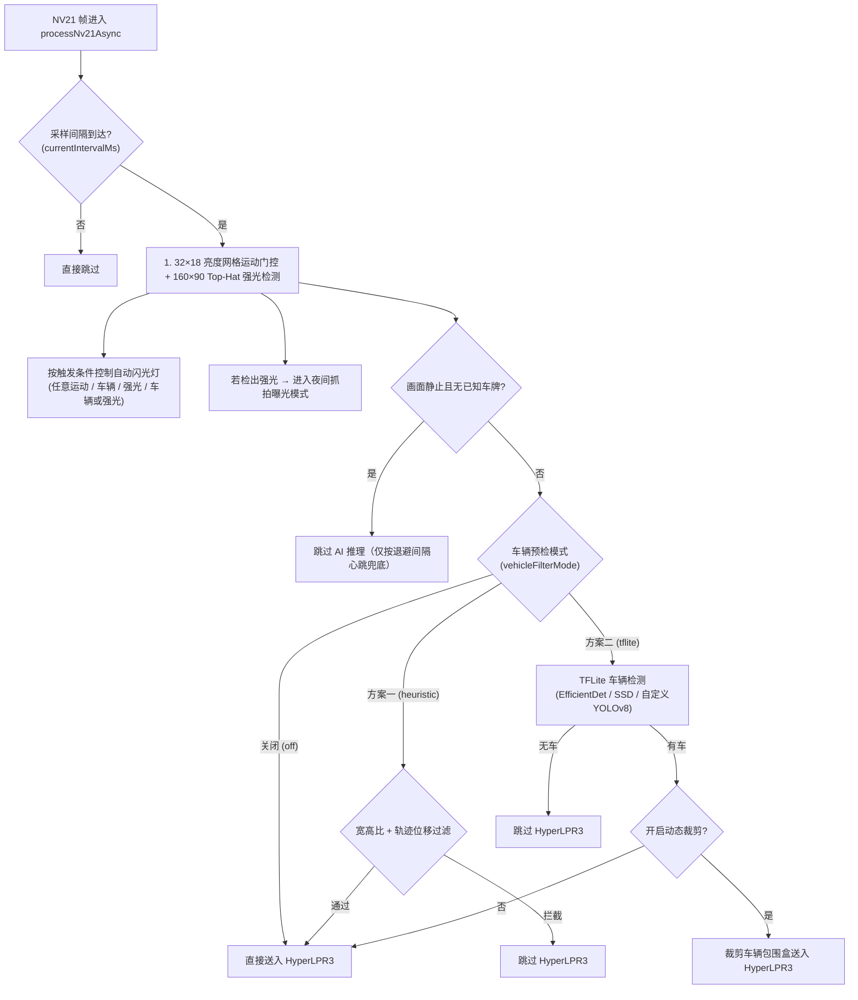

# 运动门控、车辆预检与强光抓拍机制

本模块全部位于 [PlateRecognizer.kt](file:///home/chunxiaobian/Projects/Android_ANPR/app/src/main/kotlin/com/github/digitallyrefined/androidipcamera/helpers/PlateRecognizer.kt)，用于在进入高耗时的 HyperLPR3 车牌识别前完成**节能门控、车辆筛选与夜间强光防过曝联动**。

---

## 一、总处理链路

> [!NOTE]
> **退避分离设计**：静止退避（`motionBackoffMs`）**只对 TFLite/HyperLPR 推理生效**；`analyzeSceneMotion`（动作与强光检测）始终按 `intervalMs` 全速运行，保证物体或车灯一出现就能毫秒级唤醒。

---

## 二、运动门控（`analyzeSceneMotion`）

- 在活动 ROI 内采样 **`32×18 = 576` 个亮度网格**，计算本帧与慢速自适应背景 `lumaBg` 的差值，并扣除全帧平均亮度偏移 `shift`（抵抗相机 AE 自动曝光微调引起的整帧漂移）。
- 当变化面积超过 `motionAreaRatio` 时判定为有运动，并做 4-邻域连通域聚类得到最大运动团块 `clusterNorm`；若全帧超过 `motionGlobalJumpRatio`（默认 `75%`）同时跳变（如开关房间主灯），自动重置背景防止误触发。

---

## 三、运动车辆预检双方案

### 方案一：几何与轨迹启发式过滤（`heuristic`，耗时 < 0.1 ms）
- 检查运动团块面积（`>= 0.008`）、宽高比（`0.50`–`6.5`）及前后帧质心连续位移（`dist >= 0.006`），过滤小面积树叶抖动和细长立柱/行人。

### 方案二：可替换 TFLite 轻量车辆检测（`tflite`）
- 内置 3 个量化模型并在网页端支持上传自定义 `.tflite` 模型：
  - `vehicle_efficientdet_lite0.tflite`（`320×320`，推荐均衡）
  - `vehicle_efficientdet_lite1.tflite`（`384×384`，高精度远距）
  - `vehicle_ssd_mobilenet.tflite`（`300×300`，极速轻量）
- **多格式自动适配**：
  - 支持 SSD / EfficientDet 4 输出格式（`locations / classes / scores / num_detections`）与 `UINT8` / `FLOAT32` 输入；
  - 支持 Ultralytics **YOLOv8n / YOLO11n** 单输出 TFLite 格式（`[1, 4+C, N]` 或 `[1, N, 4+C]`，内置 IoU NMS）。
- 检测到 `car / motorcycle / bus / truck` 后，在实时监控画面用**橙色虚线框**标出；若开启「动态裁剪识别」，仅裁剪车辆包围盒（外扩 12%）送入 HyperLPR3，同时保留完整 ROI 快照供事件存图。

---

## 四、160×90 白顶帽强光检测（`detectMovingGlareTopHat`）

- **高分辨率采样**：在 ROI 内采样 `160×90` 的 Y/U/V 网格，比运动网格精细 25 倍。
- **可分离 9×9 白顶帽变换**：计算 `TopHat = 原图 - 开运算(原图)`，自动消除大面积亮墙、白昼地面与背景光照渐变，只突出局部强光源。
- **前大灯 + 红尾灯双特征**：
  - **白/暖黄前大灯**：中性色度（`|U-128| <= 45 && |V-128| <= 45`）且满足 `(Y >= 185 && TopHat >= 阈值) || Y >= 215`；
  - **红色尾灯**：高红差特征（`Y >= 130 && V >= 150 && (V - U) >= 28`）；
  - 两者均需满足相对时间背景的正向亮度跳变（`bgDiff >= temporalThresh`），从而排除静止路灯。
- 检出后在实时画面用**金黄色虚线框（「强光」）**标注，并可联动切换抓拍曝光策略或自动开启闪光灯。
